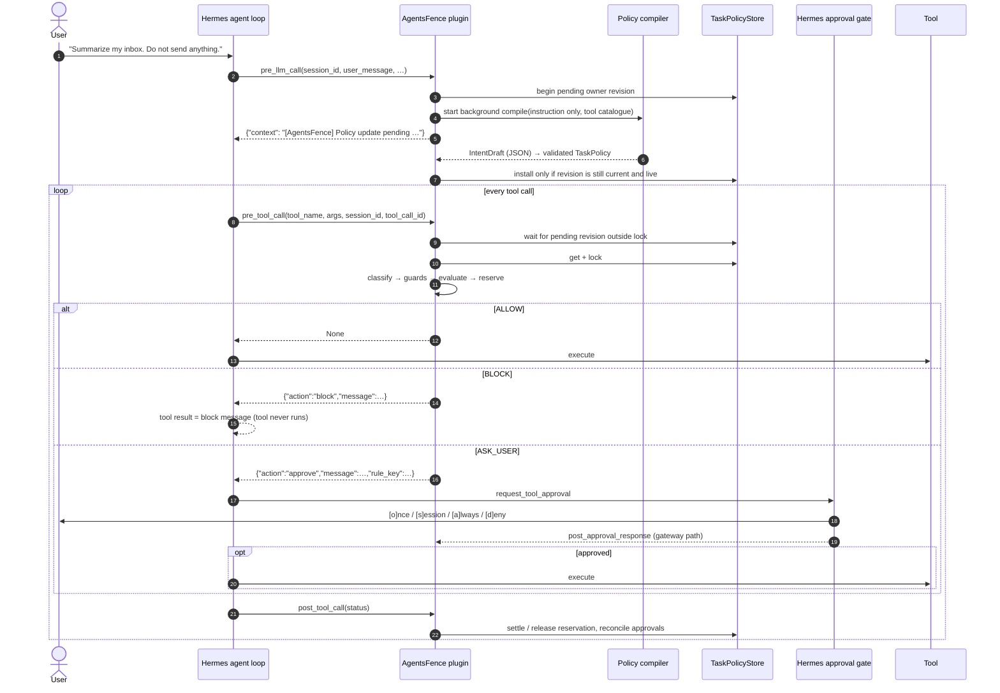

# Architecture

AgentsFence has two stages joined by a store:

- The **compiler** interprets every owner turn in the background, behind a policy revision barrier.
- The **evaluator** runs on every tool call and never calls an LLM.



## Modules

| Module | Responsibility |
|---|---|
| `models.py` | Pydantic models: `TaskPolicy`, `ToolConstraint`, `Grant`, `Decision`, `ExecutionState`, `RiskClass`, `Verdict`, `AuditEvent`. |
| `config.py` | Loads `policies/defaults.yaml`, deep-merges `$AGENTSFENCE_HOME/config.yaml`, applies env overrides. |
| `risk.py` | `RiskClassifier`: tool → `(capability, risk class)` using explicit mappings, glob patterns, then verb inference. Also the shell-command sub-classifier and target extraction (recipients, URLs/domains, paths) with Unicode normalization. |
| `compiler/` | `split.py` removes quoted material; `floor.py` applies restrict-only prohibitions; `interpret.py` holds the compact intent prompt, schema and client; `validate.py` binds grants; `merge.py` applies changes; `pipeline.py` orchestrates compilation and read-only fallback. |
| `guards.py` | Checks that don't depend on the policy: self-protection (the agent may not modify AgentsFence state, the plugin, or Hermes config and secrets), secret-file access, and exfiltration-shaped URLs. |
| `evaluator.py` | Deterministic `ALLOW` / `BLOCK` / `ASK_USER`, as an ordered list of checks (below). |
| `policy_store.py` | Per-session `PolicyRecord`: policy, counters, pending approvals, reservations. Protected by an RLock; persisted atomically at mode 0600; subagent links. |
| `audit.py` | JSONL audit log (0600) with argument redaction, and a JSON log formatter. |
| `plugin.py` | Hermes hook handlers plus `register(ctx)`. Every handler catches all exceptions: `pre_tool_call` converts them to `block`. |
| `render.py` | Human-readable policy summaries plus block and approval messages. |
| `testkit/` | Mock MCP-style workspace, six scenarios, injection probes and a profile test harness. |
| `profiles.py` | Discovers profiles, writes fail-closed loaders and managed auxiliary routes, and synchronizes inherit with the profile default. |
| `diagnostics.py` | Doctor and desktop status: runtime registrations, Hermes process listing, restart guidance, compiler error messages. |
| `desktop_api.py` | Desktop routes mounted behind Hermes' dashboard authentication: status, profiles, protection, settings, checks and profile tests. |
| `host_probe.py` | Explicit compiler and capability probes run in Hermes' own Python and profile. |
| `approvals.py` | Hermes' effective approval mode, shared by status and preflight. |
| `failsafe.py` | Standard-library fail-closed loading: blocking hook, load records, the `hermes agentsfence` status command. Copied into setup-written loaders. |
| `host_client.py` | Asks Hermes through its launcher (`hermes -p <profile> agentsfence status|probe --json`); bounded, isolated, identity-checked; never starts Hermes while it has update work pending. |
| `hermes_env.py` | Standard-library view of Hermes' installation: its interpreter (from Hermes' own `installs/<key>/facts.json` when its package manager owns the environment), pending update work, task-routing detection outside Hermes, and setup's install step (`hermes pm install`). |
| `testkit/` | Scenario harness, native approvals, mock tools, optional live model run and scheduled-job inspection. |
| `cli.py` | `setup`, `install`, `protect`, `unprotect`, `settings`, `test`, `doctor`, `audit`, `classify`, `uninstall`. |

## Policy model

```python
TaskPolicy:
    policy_id, task_id, session_id, purpose, summary
    allowed_tools            # tool names, capabilities (email.read), globs, or risk classes
    denied_tools             # same syntax; deny beats allow
    allowed_risk_classes     # default [READ]
    explicit_tool_constraints # user target restrictions, checked before runtime grants
    tool_constraints         # manual and single-grant constraints
    intent_constraints       # complete per-grant alternatives, without crossing target dimensions
    allowed_external_domains, allowed_recipients, allowed_paths
    restricted_external_domains  # explicit only-domain boundary; grants cannot bypass
    allow_local_writes, allow_external_writes, allow_destructive_actions,
    allow_financial_actions, allow_execution, allow_permission_changes   # class ceilings
    max_external_writes      # outbound budget for the whole task
    requires_approval        # always ASK_USER
    user_prohibitions        # explicit "don't" statements; absolute
    grants                   # minimal deltas approved at runtime
    source, compiler_model, request_digest (sha256 prefix, not the text)
    interpretation           # display/audit statements and selected instruction quotes
    created_at, expires_at, revision, pending_revision, suspended_since
```

A call is **authorized** only when two conditions hold:

1. Its risk class's **ceiling flag** is on. For example, COMMUNICATION requires `allow_external_writes`.
2. It is **listed**, either by name, capability or glob in `allowed_tools`, or by its class in `allowed_risk_classes`.

`UNKNOWN` tools can be listed only by exact name in a manual policy. Because both conditions are required, a stray `allowed_tools: [file.delete]` can't enable deletion unless `allow_destructive_actions` is also true. The compiler derives ceilings from structurally validated model grants; the model's reading still determines whether those grants match your intent.

### Interpretation and structural validation

The compiler model's reading of the owner's message is the trust boundary. Structural validation cannot verify meaning: a valid span can still be interpreted incorrectly. A premium compiler model is recommended. The one-call response contains an interpretation followed by grants, prohibitions and change operations. Interpretation statements and quotes are stored for display and audit only; the evaluator never uses them as authority.

The static prompt precedes the tool catalogue and request. `compiler.stages` defaults to 1; 2 separates interpretation and intents for evaluation comparisons. An unparseable response may retry once within the original total budget. Missing authority does not trigger a retry or deterministic repair.

Validation only restricts model grants:

- A grant's span must occur in the original instruction after `split_instruction()`, with Unicode and whitespace normalization. Its own negation drops it. Informational and hypothetical intents grant nothing; conditional intents require approval.
- Capabilities must resolve through the configured classifier and live catalogue. Wildcards, unknown capabilities and ambiguous multiplexed-tool grants are dropped.
- Each grant carries its own recipients, domains, paths and call limit. Target values must occur inside its span. Source/context targets grant nothing; only recipient roles for communication/share and destination roles for writes bind authority. Roots and the home directory are refused. File saves never imply memory or skill authority.
- Independent grants keep their bindings separate, including alternative grants for the same capability, so recipients, destinations and budgets cannot cross-combine.
- FINANCIAL and PERMISSION_CHANGE require approval by default, including explicit requests. The compiler setting can change that default.
- Deterministic full-instruction prohibitions and explicit only-domain boundaries remain BLOCK floors, including after truncation or failure. These language heuristics only restrict; they never restore missing authority.

Every owner turn amends. `revoke` removes matching policy and runtime grants; `narrow` intersects existing targets and takes the smaller call limit; `replace` removes the old scope before validating added grants. References can bind only to previously authorized targets. Earlier permissions otherwise persist. Execution counters and prohibition origins survive revisions. A failed amendment suspends consequential authority until a successful update; reads remain subject to existing restrictions.

The offline compiler evaluation corpus measures over-grants and under-grants through the evaluator. Zero over-grants in that corpus is an acceptance threshold, not a guarantee about unseen messages or model behavior.

## Evaluation order

Hard stops are checked together, and the most restrictive answer wins: a BLOCK is never downgraded to a question by an earlier check.

1. **Expired** → BLOCK.
2. **Self-protection guard**: modifying protected paths (AgentsFence state, the plugin, any profile's Hermes `config.yaml` / `.env` / `auth.json` / `plugins/`), or running `hermes plugins|config|hooks…` or `pip uninstall agentsfence` → BLOCK.
3. **User prohibitions and explicit only-domain bounds** → BLOCK. These cannot be overridden by grants or approvals; outside-domain reads are blocked too. A web/browser call, or a shell command running a recognized network program, must have verifiable destinations (`risk.shell_network`); unverifiable ones block.
4. **Deny list** → BLOCK. Deterministic `explicit_tool_constraints` are checked before runtime grants; a later narrowing cannot be bypassed by an earlier approval. Ordinary compiler constraints remain after exact-action grants.
   - *Remembered questions*: reading secrets, other state-changing shell commands inside the Hermes home, `cross_profile` writes, and patch text that names no parseable files → ASK_USER, combined with the result below.
5. **Revision barrier and suspension**: while an owner revision is pending, every tool call waits outside the store lock until its hook deadline. If still pending, ASK_USER (BLOCK under strict/yolo). After a failed amendment, consequential actions remain suspended before runtime grants; reads retain their existing bounds. User prohibitions still BLOCK first.
6. **Runtime grant for this exact action** (same tool, capability, risk class and action fingerprint, uses left) → ALLOW. A grant also satisfies the remembered questions, since you approved exactly this action.
7. **`tool_constraints`**: recipient, domain or path outside the constraint, or `max_calls` exhausted → BLOCK. Writes and deletes with verified paths count distinct files, so rewriting a file the task already touched uses nothing new; every other call counts once.
8. **Ceiling and listing**: if the call isn't authorized, use the configured verdict for its class. By default DELETE, FINANCIAL and PERMISSION_CHANGE → BLOCK; everything else → ASK_USER. UNKNOWN tools can be listed only by exact name in a user-written (`source: manual`) policy.
9. **Recipient binding** (COMMUNICATION, PERMISSION_CHANGE, and external writes carrying people): a compiled policy requires each recipient to match an address named by the user. A browsing domain cannot widen a send or share grant. A manually written policy may authorize a whole recipient domain when it lists no individual recipients. Recipients that can't be determined, or compiled authority with no bound recipients → ASK_USER.
10. **Domain allowlist**: consequential call → BLOCK; read → ASK_USER.
11. **Exfiltration-shaped URL** (long query, long encoded token, embedded email or credentials) → ASK_USER.
12. **Path allowlist** for writes and deletes → BLOCK (ASK_USER if the patch text named no parseable files).
13. **Outbound budget** (`max_external_writes`) → BLOCK.
14. **`requires_approval`** → ASK_USER.
15. Otherwise **ALLOW**.

After that:
- When Hermes would auto-approve (`--yolo`, `approvals.mode: off`, an exact session/permanent allowlist hit, or an unattended cron run), ASK_USER becomes BLOCK if `strict_yolo` is on, and always under the read-only fallback policy. The exact rule key is checked against Hermes' approval store before returning a question.

### Classification details that matter for security

- **Arguments can change the class.** `arg_risk` maps an argument value to a class (`send_message(action="list")` is READ). `arg_present_risk` escalates when an argument is present (`browser_console(expression=…)` is EXECUTION). `patch_args` names arguments holding patch text. Its `*** Add/Update/Delete File:` headers, both sides of `*** Move File: a -> b`, and unified-diff headers become paths. Headers are matched with Hermes' whitespace-tolerant grammar (case-insensitively, so AgentsFence sees a superset of what Hermes applies), and the result is unioned with Hermes' own `tools.patch_parser.parse_v4a_patch` when it can be imported. `Delete File` escalates to DELETE; patch text naming no parseable file asks.
- **Multiplexed tools.** When a tool classifies as READ but carries an `action`, `operation`, `op`, `method` or `verb` argument, that value must be declared a read (`read_actions`, or `arg_risk` → READ). Otherwise the value is classified by its verb (`save` → EXTERNAL_WRITE, `remove` → DELETE), or as UNKNOWN. `defaults.yaml` maps Spotify, Discord and `send_message` actions explicitly.
- **Shell.** Compound commands are split and the worst segment wins. Commands treated as reads are checked option by option, and git subcommands check their mutating forms first. Environment-variable prefixes and programs outside system directories are EXECUTION.
- **Action fingerprint.** `sha256` over the tool, capability, risk class, extracted recipients/domains/paths, and either the tool's declared `action_args` (`terminal.command`, `execute_code.code`, `browser_console.expression`) or every argument except message content. Opaque patch text is included verbatim. Grants and Hermes approval keys are bound to this fingerprint.

## Hermes integration details

The verified contracts are in [HERMES_API.md](HERMES_API.md). The points that matter for correctness:

- **Verdict mapping.** Hermes has no explicit "allow" directive: ALLOW → return `None`; BLOCK → `{"action": "block", "message": …}`; ASK_USER → `{"action": "approve", "message": …, "rule_key": …}`.
- **Directive precedence and argument rewrites.** Capability preflight requires native BLOCK-over-approve precedence. The runtime inspects the live registry before each tool call: any other `pre_tool_call` callback or any `tool_execution` middleware blocks the call with an explicit compatibility error. Both can rewrite arguments after authorization on the pinned hosts. `tool_request` middleware is supported because Hermes applies it before AgentsFence checks the resulting arguments. Callback order is never changed. Doctor and lifecycle verification report incompatible extensions.
- **Fail-closed.**
  - Hermes swallows hook exceptions and runs the tool, so `on_pre_tool_call` wraps everything and returns `block` on any internal error.
  - `register()` registers the enforcement `pre_tool_call` hook before anything optional and records an explicit outcome: `enforcing`, or `recovery_block` when construction or a required hook fails, in which case it installs a blocking hook and still returns normally. Optional steps (auxiliary task, commands, status command, runtime and load records) are logged on failure and never remove enforcement.
  - The loader that setup writes (`failsafe.py`, standard library only, copied into each profile's `plugins/agentsfence/__init__.py`; a git checkout's root `__init__.py` loads it by path) guards both the import and `register(ctx)`. On any failure, or a non-`enforcing` outcome, it installs a blocking hook first, then best-effort records `load_status` and registers the status command. It only helps when Hermes runs it.
  - A host LLM factory is resolved lazily, so a broken host model degrades to the read-only fallback instead of preventing registration.
- **Session keying.** `task_id` can change on every turn, so records are keyed by `session_id`, with `task_id`s stored as aliases that resolve through subagent links. A call carrying only a task id that maps to no record is blocked (`no-policy-for-task`); it never gets a fresh fallback policy.
- **Approval reconciliation.**
  - `rule_key = agentsfence:<policy_id>:<sha256(tool, capability, rule, action fingerprint)>`. An `[a]lways` answer therefore persists only for this exact action within this task.
  - Hermes fires `post_approval_response` for plugin approvals only on the gateway path. On the CLI prompt path, and for yolo, allowlist or cron auto-approval, a `post_tool_call(status != "blocked")` for a pending call records a single-use grant.
  - `smart_approve` (an auxiliary LLM's decision) never mints a grant.
- **Call-count races.** Evaluation and reservation happen under one lock. Counters are reserved for ALLOW and for ASK_USER while the user decides, so parallel calls can't pass `max_calls` or the outbound budget. A reservation is released when the call is blocked downstream or the approval is denied.
- **Subagents and nested dispatch.** `subagent_start` links the child session to the parent record: same policy, same counters. The child's first `pre_llm_call` (goal text written by a model) is never compiled, but its task id is aliased to the parent. Calls that `execute_code` dispatches with only a task id therefore resolve to the parent's policy.
- **Follow-up turns.**
  - Every owner message starts a pending revision and is compiled and merged; the newer explicit statement wins. A new "don't send" removes an older send permission; a new evidenced "send it to john@…" lifts an older send ban.
  - Earlier permissions remain unless the user explicitly narrows them. "only / instead" replaces the relevant recipients, domains or paths, including the scope of broader class/capability/tool grants and earlier approvals. Additive constraint lists merge field by field, keeping older limits the new message does not mention.
  - In a shared chat, messages from anyone other than the task's owner (`sender_id`) can only add prohibitions.
- **Lifecycle.**
  - `on_session_reset` (`/new`) drops the record.
  - `on_session_finalize` with reason `shutdown` keeps it, so `--resume` keeps its restrictions. Other finalize reasons drop it.
  - Expired records are pruned at startup.
- **`/fence`.** The slash-command handler receives no session context. In a gateway process it refuses, rather than risk showing one chat's task to another.

## Data at rest

| Path (under `$AGENTSFENCE_HOME`, default `~/.hermes/agentsfence`) | Contents | Mode |
|---|---|---|
| `policies/<session>.json` | the policy record, including counters, grants, interpretation and unresolved owner instructions | 0600 (directory 0700) |
| `policies/<child>.link.json` | subagent → parent link | 0600 |
| `audit.jsonl` | decisions and lifecycle events; argument values redacted except recipients, URLs, paths and actions | 0600 |

With policy persistence enabled, every owner instruction is saved in full after `split_instruction()` strips quoted material, in the record's `unresolved` queue before compilation starts. Failed or superseded updates remain queued across restarts until a successful latest revision covers them. That success removes the covered instructions from the saved queue. Interpretation statements and selected quotes remain in policy records and compilation audit rows; quotes can include an entire short request. The policy also keeps a `sha256:` request digest and the compiler's summary; the audit hashes that summary and does not separately store the unresolved queue.

`/new` (`on_session_reset`) and non-shutdown session boundaries delete the record. Shutdown keeps it for resume. Expiry immediately prevents use of its authority; expired files are pruned when the store starts or when a new owner turn replaces the expired task, rather than by a background deletion timer. The default policy TTL is 12 hours. Deleting a record or clearing its queue does not remove retained interpretation quotes from the separately rotated audit log.

## Network

AgentsFence makes outbound requests only for policy compilation, using Hermes' configured model routing and credentials by default. Compilation runs on every owner turn. Compilation may retry once for unparseable output, within the original total budget. Every draft passes the same span, capability and target validation. No deterministic pass restores omitted consequential grants. If authority remains uncertain, the policy explains the missing permission and the normal approval or blocking path applies. A failed compile uses a conservative fallback; explicit prohibitions and only-domain bounds remain active. There is no telemetry.

## Profile and desktop surfaces


`diagnostics.py` supplies CLI and desktop snapshots. Doctor computes its overall result from three checks, each ok, problem or unverified: (1) **new-process load**, asked of Hermes itself through `host_client.py`, which runs `hermes -p <profile> agentsfence status --json` with no `PYTHONPATH` from the caller, bounded, identity-checked, and left running (never killed) if Hermes outlives the timeout; (2) **running processes**: registrations checked against PID/start identity, version and the restart digest (`configuration_digest`, settings AgentsFence reads only at load), plus a scan of the user's Hermes processes, where an unavailable scan is unverified; (3) **compiler evidence**: compile, amend and probe audit rows carry provenance captured when the operation starts (version, `evidence_digest` of the compiler route, grant and every outcome-changing compiler setting, Hermes' routing mode, actual model), and only evidence matching the current version and evidence digest is current. Load-status records (`load_status/<profile>-<python>.json`) are history only. The authenticated Hermes dashboard mounts `desktop_api.router`; no separate public AgentsFence server is started.

`desktop/` and `dashboard/` are the canonical assets. Hatch includes them under `agentsfence/surfaces` when building a wheel; no second tracked copy exists. Setup materializes assets for wheel installs and leaves directory checkouts unchanged. Directory hooks and dashboard routes use the checkout's isolated package namespace, so an installed wheel cannot supply different code.

Owner turns apply the deterministic floor under the store lock, mark a pending revision and return a generic context note immediately. Background workers share a bounded pool. Pool waits and execution share the request deadline; abandoned workers retain their slot until they return. Tool calls wait on a condition outside the store lock, then evaluate the current revision. Installation accepts only the latest pending revision of a live session; stale results are discarded. Each owner message (after `split_instruction()`) stays queued on the session record until a successful compile interprets it, so each compile covers every queued message, oldest first: a superseded or failed revision's message, such as a revocation, is never skipped. If the queue exceeds the compiler input limit, the revision fails and consequential authority stays suspended rather than truncating newer messages. In that rare case, earlier deterministic prohibitions in the queue still apply to later requests in the same batch. Session drop or expiry wakes waiters with BLOCK. Saturation produces an explicit fallback. Execution counters survive installation.

Status uses an incremental audit cursor with bounded rows and query count, detecting rotation, truncation and an incomplete final append. Desktop status verifies its own process and actual hook. CLI doctor, and Desktop setup for each saved profile, check other processes' fresh identities and list Hermes processes that never registered. Approval reporting and preflight share Hermes defaults and effective YOLO state. Fallback state, sanitized errors and prohibition origins are persisted on policies and exposed in operator views. Audit events normalize delegated actions to the parent and retain the source child identifier. Test session scopes include nested descendants and legacy child-ID decisions, within the test run/profile/log boundary.

## Operator lifecycle

`lifecycle.py` handles install, protect, unprotect, settings and uninstall. Required host capabilities are checked before writes. An OS lock serializes operations; snapshots and a journal make failures recoverable. Failed rollback retains the journal and backups for the next command. Every protected profile is verified after an environment switch.

Accepted PM contract for 0.2.0a8: a fresh `install` registers disabled surfaces without a dependency build; first `protect` enables the selected profiles and installs through `hermes pm install`. Protect/upgrade publishes guarded files before the build, verifies every protected profile, then pins loaders to the new version. On failure, restore files and rebuild from prior declarations if a build started. Publication is atomic per file, not across all profiles; tool calls may temporarily block. Persistent disabled machine dependencies and build-before-activation staging are deferred enhancements requiring supported Hermes APIs and do not block this release.

Shared settings live at `<root>/agentsfence/settings.yaml`; optional profile overrides are in `<profile>/agentsfence/config.yaml`. This distinct filename preserves existing default-profile override files during migration. Compiler routes are managed implementation details: Hermes resolves empty routes against live chat models, so inherit uses a synchronized profile-default route. An unset or unroutable default cannot silently compile with `-m`; it falls back safely.

The test-only read compiler lives in `tests/rules_client.py`. Production compiles use Hermes and preserve deterministic full-instruction prohibitions, only-domain restrictions and read-only fallback.
